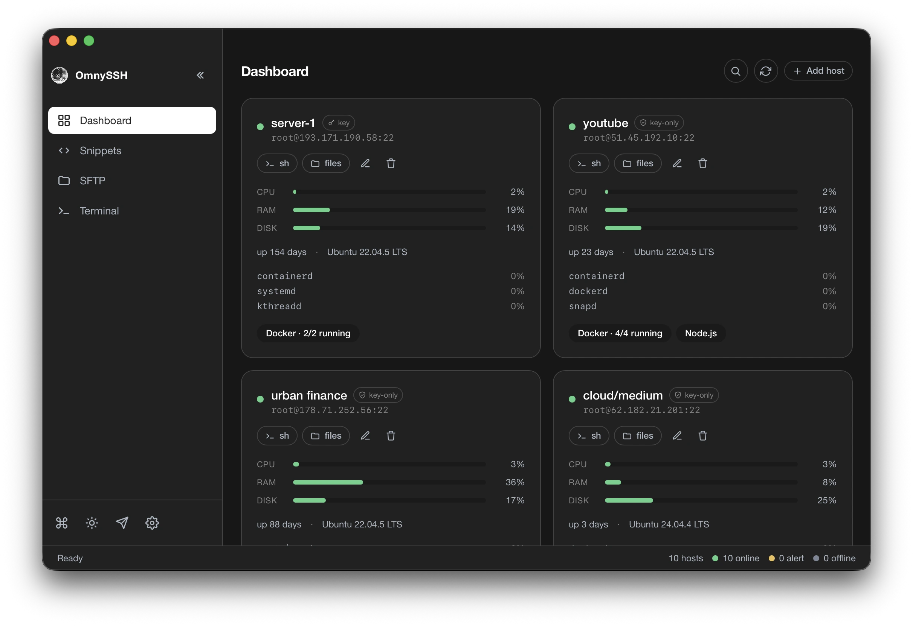

<div align="center">

# OmnySSH

### Все серверы в одном окне: дашборд, терминал, SFTP, сниппеты

**Форк [timhartmann7/omnyssh](https://github.com/timhartmann7/omnyssh) с собственными доработками** · [чем отличается](#чем-этот-форк-отличается-от-оригинала)



[](LICENSE)

</div>

---

> [!IMPORTANT]
> ## Это форк
>
> Проект основан на **[timhartmann7/omnyssh](https://github.com/timhartmann7/omnyssh)** — это его форк с собственными правками, а не оригинальная разработка.
> Движок SSH, дашборд, терминалы, сниппеты, работа с ключами и TUI-версия взяты из оригинала; изменены работа с файлами на сервере, вид карточек серверов и хранение хостов, убраны встроенные проверки обновлений и диалог поддержки.
>
> Оригинал: <https://github.com/timhartmann7/omnyssh> · Лицензия Apache-2.0 сохранена.

## Чем этот форк отличается от оригинала

Коротко — в таблице, подробности ниже.

| Область | Оригинал | Этот форк |
|---|---|---|
| Файлы на сервере | Просмотр первых 4 КБ | Полноценный редактор: открыть, изменить, сохранить на сервер |
| Путь в SFTP-панели | Строка пути без действий | Хлебные крошки: переход в любую родительскую папку, копирование всего пути одной кнопкой |
| Действия с файлом | Панель инструментов: загрузка, скачивание, новая папка, переименование, удаление | Плюс контекстное меню на каждой строке: открыть, изменить, просмотреть, скачать/загрузить, переименовать, права, удалить |
| Права доступа | Не было | Диалог `chmod` с галочками r/w/x для владельца, группы и остальных |
| Переименование | Только на сервере | И на сервере, и локально |
| Карточки серверов | CPU, RAM, диск, аптайм, версия ОС, топ процессов и обнаруженные сервисы | Только CPU, RAM и диск — карточки ниже и компактнее |
| `~/.ssh/config` | Импортировался при старте | Не читается вообще; единственный источник хостов — `hosts.toml` |
| Проверка обновлений | В TUI и GUI, с self-update | Удалена полностью |
| Диалог поддержки | Кнопка с Telegram и ссылками | Удалён вместе с плагином `opener` |
| Версия | 1.1.5 | 1.2.0 |

### Редактор файлов на сервере

Оригинал по клику на файл на сервере (в правой панели) показывал первые 4 КБ в режиме только для чтения. Здесь файл открывается целиком в редакторе и сохраняется обратно по SFTP:

- **Сохраняется весь файл**, а не фрагмент: `⌘S` / `Ctrl+S` пишет содержимое прямо на сервер. Права файла не меняются, а если ничего не правили — файл не перезаписывается.
- **Проверка по содержимому, а не по расширению.** Открываются PHP, HTML, CSS, шаблоны, конфиги и файлы без расширения — `.htaccess`, `~/.ssh/config`, `nginx.conf` и подобные.
- **Понятный отказ вместо порчи файла.** Бинарный файл, не-UTF-8 или файл больше 2 МиБ не открывается с обрезанным содержимым, а отклоняется с причиной.
- **Окно редактора занимает 90% высоты окна**, ширина прежняя. Переноса строк нет: длинная строка уходит в горизонтальный скролл, длинный файл — в вертикальный.
- **Защита от потери правок.** Несохранённые изменения помечены, закрытие с ними требует подтверждения, ошибка сохранения оставляет диалог открытым с текстом.
- `Tab` делает отступ, а не переводит фокус. Пункт **Preview** в контекстном меню по-прежнему показывает быстрый просмотр первых 4 КБ.

### Контекстное меню по правой кнопке

В обеих панелях появилось меню действий над строкой:

- **Open** — войти в папку;
- **Edit** — открыть файл на сервере в редакторе;
- **Preview** — быстрый просмотр;
- **Upload / Download** — передать файл или папку;
- **Rename…** — переименовать, теперь и локальный файл тоже (через файловую систему, а не SFTP);
- **Permissions…** — права доступа;
- **Delete** — удалить на сервере.

Меню закрывается по клику вне его, `Esc`, изменению размера окна и потере фокуса.

### Права доступа галочками

Пункт **Permissions…** читает текущий режим файла и показывает таблицу «владелец / группа / остальные» с галочками **Read**, **Write**, **Execute**. Рядом видны восьмеричная запись (`644`) и вид `ls -l` (`rw-r--r--`). **Save** применяет новый режим одним `chmod`. Биты setuid/setgid/sticky сохраняются как были.

### Хлебные крошки в пути SFTP

В оригинале путь над списком файлов был простой строкой. Здесь он стал навигацией:

- **Каждый сегмент кликабелен**: из любой вложенной папки можно вернуться сразу к любому родителю, а не только на уровень выше.
- **Копирование всего пути** — кнопка справа от крошек. После нажатия иконка меняется на галочку, полный путь уже в буфере обмена.
- Работает в обеих панелях и понимает POSIX-пути, буквы дисков Windows и UNC-пути (`\\server\share`).

### Компактные карточки серверов

В оригинале карточка показывала ещё аптайм, версию ОС, топ процессов по CPU и обнаруженные сервисы. В этом форке этих блоков нет: карточка заканчивается полосами **CPU / RAM / Disk**. Остались имя и адрес хоста, бейдж ключа, кнопки `sh` / `files`, настройка ключа, редактирование и удаление. За счёт этого карточки заметно ниже, а сетка плотнее.

### `~/.ssh/config` больше не импортируется

В оригинале хосты из `~/.ssh/config` подмешивались к своим при каждом запуске: карточки помечались бейджем «ssh config», редактирование такой карточки создавало собственную копию, а `ProxyJump` мог ссылаться на алиас из SSH-конфига.

В этом форке импорт удалён вместе с парсером SSH-конфига и его тестами:

- Единственный источник хостов — `hosts.toml` приложения. Хосты добавляются вручную.
- `ProxyJump` разрешается только по именам из `hosts.toml`; совпадение по «исходному» имени из SSH-конфига убрано.
- Из формы и карточек убраны бейдж источника, подсказка про «adoption» и особые правила для импортированных хостов.
- Ваш `~/.ssh/config` приложение не читает и никогда не изменяет — но и хосты оттуда больше не появляются сами.

### Проверка обновлений удалена

Убрана целиком, в обоих интерфейсах:

- в ядре — модуль проверки GitHub Releases, события `UpdateAvailable` / `UpdateInstalled` и зависимости `reqwest`, `semver`, `flate2`, `tar`, `self-replace`;
- в TUI — стартовый попап обновления, его кнопки и состояние в `App`;
- в GUI — команды `check_update` / `install_update` / `load_update_config` / `save_update_config`, баннер обновления, хранилище состояния и настройки в Settings;
- из Tauri — плагин `tauri-plugin-updater` и его конфигурация;
- из конфига — секция `[update]` (`check_on_startup`, `skip_version`).

Обновляться нужно вручную: пересобрать из исходников и заменить приложение.

### Диалог поддержки и внешние ссылки удалены

Кнопка поддержки в сайдбаре, модальное окно с Telegram-каналом и ссылками на GitHub, а также IPC-обёртка для открытия внешних URL убраны. Вместе с ними удалён `@tauri-apps/plugin-opener`, его Rust-зависимость и разрешения `opener:allow-open-url` в capabilities. Приложение больше не открывает внешние ссылки в браузере.

---

## Возможности

### Живой дашборд
Карточка на каждый хост: CPU, RAM и диск полосами. Полосы желтеют, затем краснеют — проблемный сервер видно издалека. В десктопе сетку можно группировать по тегу, сортировать по имени или статусу, а карточки — перетаскивать в собственный порядок, который сохраняется между запусками.

### Настоящие терминалы
Полноценные PTY-сессии во вкладках. Открывайте столько серверов, сколько нужно, переключайтесь между ними в сайдбаре и оставляйте их работать, пока смотрите дашборд.

### Две панели SFTP
Локально слева, сервер справа. Отмечайте файлы и папки галочками и переносите их, перетаскивайте строку в другую панель или прямо из Finder/Explorer на сервер. Прогресс, отмена, передача папок целиком с сохранением прав, колонка «Modified» с полной датой по наведению, кликабельные хлебные крошки с копированием пути. Плюс редактор на сервере, контекстное меню и `chmod` — см. [отличия](#чем-этот-форк-отличается-от-оригинала).

### Сниппеты
Сохраняйте команды, которые вставляете каждую неделю. Выберите сниппет, отметьте хосты — он выполнится на всех сразу. Сниппеты принимают параметры: `sudo systemctl restart {{service}}` спросит имя сервиса.

### Поиск по всему
`⌘K` — и печатайте. В списке все хосты и все открытые сессии. `Enter` открывает терминал на выбранном хосте или возвращает в сессию, из которой вы вышли.

### Streamer mode
Подменяет реальные IP на экране на фальшивые. Записывайте демо или показывайте экран, не раскрывая инфраструктуру. Включается из настроек, из палитры команд и по `⌘⇧S` / `Ctrl+Shift+S`; глаз в статус-баре показывает, что режим включён.

### Светлая и тёмная темы
Обе есть в приложении, переключаются в сайдбаре.

### Трей и фоновая работа
Поведение при закрытии окна настраивается: выходить совсем или сворачиваться в трей, не обрывая сессии и туннели. Настройка показывается там, где система поддерживает трей.

---

## Настройка SSH-ключей

Парольный вход на свежем VPS — то, что вы всё время собираетесь починить и не чините. OmnySSH делает это в один клик.

Выберите хост без ключа и нажмите **Set up an SSH key**: приложение сгенерирует ключ Ed25519, допишет публичную часть в `authorized_keys` и переключит хост на вход по ключу. Затем оно откроет новое соединение с этим ключом, чтобы доказать, что ключ работает, и только после этого отключит парольный вход. Промежуточной кнопки «подтвердить» нет: запуск процесса означает, что он будет выполнен.

Перед изменением `sshd_config` на сервере сохраняется резервная копия. Если какой-то шаг не удался, копия восстанавливается и доступ остаётся прежним. Приватный ключ не покидает вашу машину, и ничего не отправляется никуда, кроме выбранного сервера.

Код: [`crates/omnyssh-core/src/ssh/key_setup.rs`](crates/omnyssh-core/src/ssh/key_setup.rs). Прочитайте его, прежде чем направлять это на продакшен — в этом и смысл открытого исходного кода.

Ключи с парольной фразой поддерживаются. При первом использовании приложение спросит парольную фразу и будет держать её в памяти до выхода — на диск она не пишется. На macOS и Linux ключ, уже загруженный в `ssh-agent`, используется без вопроса. Поле **Password** в форме хоста — это пароль входа на сервер, а не парольная фраза ключа.

---

## Установка и сборка

В этом репозитории нет опубликованных сборок и релизов. Готовые установщики оригинального проекта **не подходят**: они ставят OmnySSH без этих правок. Здесь приложение собирается из исходников.

### Требования

| Инструмент | Версия | Зачем |
|---|---|---|
| Rust | stable 1.89+ | ядро и TUI |
| Node.js | 20+ | только GUI |
| Tauri CLI | v2 | только GUI: `cargo install tauri-cli --version "^2"` |
| Linux | `libwebkit2gtk-4.1-dev`, `libgtk-3-dev` | только GUI |

### TUI-приложение (`omny`)

```bash
cargo build                 # ядро + TUI, без Node и Tauri
cargo run -p omnyssh        # запустить
cargo install --path crates/omnyssh   # поставить бинарь omny
```

### Десктопное приложение

Из корня репозитория:

```bash
# один раз: фронтенд-зависимости
(cd crates/omnyssh-gui/ui && npm ci)

# сборка (macOS)
(cd crates/omnyssh-gui && cargo tauri build --bundles app)

# Linux и Windows: тот же вызов без --bundles app
# (cd crates/omnyssh-gui && cargo tauri build)
```

Артефакты появляются в общем `target` workspace:

```
target/release/bundle/macos/OmnySSH.app      # macOS
target/release/bundle/appimage/…             # Linux
target/release/bundle/deb/…                  # Linux
target/release/bundle/rpm/…                  # Linux
target/release/bundle/nsis/…                 # Windows
target/release/bundle/msi/…                  # Windows
```

macOS: заменить установленное приложение свежей сборкой (из корня репозитория)

```bash
rm -rf /Applications/OmnySSH.app
ditto target/release/bundle/macos/OmnySSH.app /Applications/OmnySSH.app
```

### Проверки перед коммитом

```bash
cargo test
cargo clippy --all-targets -- -D warnings
cargo fmt --check

cd crates/omnyssh-gui/ui
npm run check
npm test
npm run test:e2e
```

---

## Где лежат данные

Все данные хранятся локально. Приложение не отправляет их третьим сторонам и не требует аккаунта: сетевые соединения идут только к вашим серверам.

| Что | Linux | macOS | Windows |
|---|---|---|---|
| Хосты, сниппеты, конфиг | `~/.config/omnyssh/` | `~/Library/Application Support/omnyssh/` | `%APPDATA%\omnyssh\` |
| Хосты | `hosts.toml` | `hosts.toml` | `hosts.toml` |
| Сниппеты | `snippets.toml` | `snippets.toml` | `snippets.toml` |
| Настройки | `config.toml` | `config.toml` | `config.toml` |

`~/.ssh/config` в этом форке не читается и не пишется — см. [отличия](#чем-этот-форк-отличается-от-оригинала).

---

## Сравнение

Замеры памяти сделаны автором оригинала на M4 Mac: оба приложения открыты и простаивают.

| | OmnySSH | Termius | tmux + ssh |
|---|---|---|---|
| RAM в простое | ~130 МБ | ~649 МБ | мало |
| Процессов | 4 | 9 | 1 |
| Дашборд с метриками | да | да | нет |
| Две панели SFTP | да | да | нет |
| Сниппеты и рассылка по хостам | да | да | нет |
| Настройка ключа в один клик | да | нет | нет |
| Нужен аккаунт | нет | да | нет |
| Телеметрия | нет | да | нет |
| Открытый исходный код | да | нет | да |
| Цена | бесплатно | платно | бесплатно |

tmux остаётся в таблице, потому что им пользуется большинство. Он выигрывает по весу и проигрывает по всему визуальному.

---

## TUI-версия

OmnySSH начинался в терминале, и TUI никуда не делся — он в этом же репозитории и собирается из тех же исходников.


Под капотом тот же движок: репозиторий — cargo-workspace, где `crates/omnyssh-core` содержит логику, а фронтенды лежат сверху. Дашборд, файловый менеджер, сниппеты, вкладки с сессиями, туннели, нечёткий поиск, четыре темы (`default`, `dracula`, `nord`, `gruvbox`) и переназначаемые клавиши в `config.toml`.

```bash
cargo install --path crates/omnyssh
omny
```

`a` — добавить хост, `/` — поиск, `g` — группировка по тегу, `x` — быстрая команда, `K` — настроить SSH-ключ, `f` — включить или выключить туннель, `?` — помощь.

Полные опции, клавиши и примеры конфига: `man omny`.

> В отличие от оригинала здесь нет стартовой проверки обновлений и попапа «Update Available».

---

## Решение проблем

**macOS: хосты в локальной сети падают с «No route to host».** macOS пускает приложение к устройствам в локальной сети только после вашего разрешения. Включите OmnySSH в System Settings → Privacy & Security → Local Network (выключить и включить снова, если уже включено) и перезапустите приложение. Для `omny` такое же разрешение нужно терминалу, в котором он запущен; у Apple Terminal оно уже есть.

**Synology: терминал завершается с «Permission denied, please try again.» сразу после пароля.** DSM даёт шелл только членам группы administrators и только при включённом Control Panel → Terminal & SNMP → Enable SSH service. Остальные аккаунты могут пользоваться SFTP.

**Хостов из `~/.ssh/config` нет в списке.** Так и задумано: в этом форке импорт удалён. Добавьте хосты вручную — они сохранятся в `hosts.toml`.

**Приложение не предлагает обновиться.** Проверка обновлений удалена. Обновление — это пересборка из исходников и замена приложения.

---

## Структура репозитория

```
crates/omnyssh-core   движок: SSH, конфиги, метрики, события — без UI
crates/omnyssh        TUI-приложение (бинарь omny)
crates/omnyssh-gui    десктопное приложение (Tauri 2 + SvelteKit)
doc/omny.1            man-страница TUI (генерируется из CLI)
scripts/              проверки гигиены репозитория
```

Правила разработки, соглашения и чек-лист — в [CONTRIBUTING.md](CONTRIBUTING.md). Учтите: часть его разделов описывает оригинальный проект и ещё ссылается на удалённые здесь updater и парсер `~/.ssh/config`.

---

## Благодарности

Оригинальный проект — **[timhartmann7/omnyssh](https://github.com/timhartmann7/omnyssh)**. Вся базовая архитектура, движок SSH, интерфейсы и TUI созданы его автором; этот репозиторий — форк с описанными выше изменениями. Условия лицензии и авторские права оригинала сохранены.

## Лицензия

Apache 2.0. См. [LICENSE](LICENSE).
